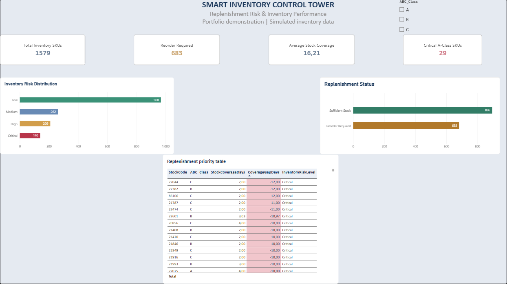
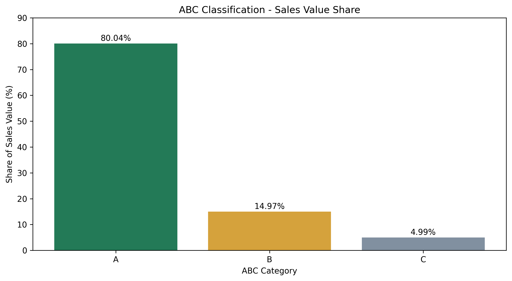
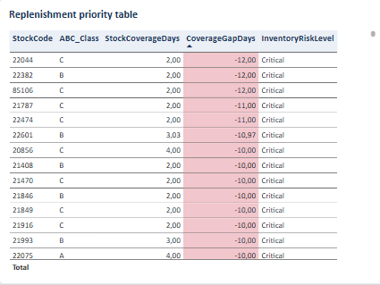

# Smart_Inventory_Control_Tower

**Supply Chain Analytics | Python | Power BI | Inventory Management**

An end-to-end supply chain analytics portfolio project combining historical sales analysis, ABC classification, simulated inventory planning, and replenishment risk monitoring.

The project demonstrates how data can support inventory planning decisions through Python calculations and interactive Power BI dashboards.

> **Project scope:** Historical retail sales data combined with simulated stock balances and supplier lead times. This is a portfolio demonstration, not a live warehouse system.

---

## 1. Business Problem

Inventory planners need to understand which products are important, which items require replenishment, and where shortages may occur.

This project addresses five business questions:

- Which SKUs contribute the most sales value?
- How can products be classified using ABC analysis?
- Which SKUs meet replenishment conditions?
- How many days of inventory coverage are available?
- Which high-value products face the greatest potential shortage risk?

## 2. Tools and Technologies

| Tool | Purpose |
|---|---|
| Python | Data analysis and inventory calculations |
| Pandas and NumPy | Data cleaning, aggregation, and simulation |
| Matplotlib | Exploratory data visualization |
| Power BI Desktop | Interactive inventory dashboards |
| DAX | KPI measures and inventory risk calculations |
| Google Colab | Notebook development |
| GitHub | Version control and portfolio presentation |

## 3. Dataset

**Source:** [UCI Online Retail Dataset](https://archive.ics.uci.edu/dataset/352/online+retail)

The source contains historical transactions from a UK online retailer between December 2010 and December 2011.

The initial analysis uses the first 5,000 transaction records.

For positive sales analysis, records with nonpositive quantities or unit prices and cancellation invoice lines were excluded.

The source provides sales transactions, but not actual current inventory balances or supplier lead times. These additional planning inputs were simulated.

## 4. Dashboard Screenshots

### Inventory Performance Dashboard

This dashboard presents stock coverage, replenishment status, and high-priority inventory risk indicators.

### ABC Sales Analysis

ABC classification ranks SKUs by their contribution to positive sales value.

### Replenishment Priority Analysis

The replenishment table highlights SKU-level inventory coverage, coverage gaps, risk categories, and suggested replenishment quantities.

## 5. Key Project Results

### Sales and ABC Classification

| KPI | Result |
|---|---:|
| Unique SKUs | 1,579 |
| Positive sales quantity | 56,340 units |
| Positive sales value | £104,055.57 |
| Class A SKUs | 361 |
| Class B SKUs | 493 |
| Class C SKUs | 725 |

### ABC Value Distribution

| Class | SKUs | Sales value | Value share |
|---|---:|---:|---:|
| A | 361 | £83,287.92 | 80.04% |
| B | 493 | £15,575.16 | 14.97% |
| C | 725 | £5,192.49 | 4.99% |

Class A accounts for approximately 22.9% of SKUs but contributes 80.04% of the positive sales value in the analyzed sample.

### Simulated Inventory Planning Results

| KPI | Result |
|---|---:|
| Total SKUs | 1,579 |
| Reorder Required SKUs | 683 |
| Average Stock Coverage | 16.21 days |
| A-Class Reorder SKUs | 157 |
| Critical A-Class SKUs | 29 |

These results use simulated stock-on-hand balances, supplier lead times, and safety stock assumptions.

## 6. Methodology

### Data Preparation

- Loaded historical retail transactions using Pandas.
- Inspected data types and missing values.
- Selected positive sales transactions.
- Calculated positive sales quantities and sales values.
- Aggregated transactions by StockCode.

### ABC Classification

- Calculated total positive sales value per SKU.
- Ranked SKUs by sales value.
- Calculated cumulative sales value contribution.
- Applied approximately 80% / 15% / 5% ABC classification thresholds.

### Simulated Inventory Planning

- Estimated average daily demand from the sample observation period.
- Generated reproducible stock balances and supplier lead times using a fixed random seed.
- Calculated stock coverage, safety stock, and reorder points.
- Calculated suggested order quantities using a simplified target-stock approach.
- Flagged SKUs requiring replenishment.

### Risk Assessment

Coverage Gap (days) = Stock Coverage Days - Supplier Lead Time Days

Products were classified as follows:

| Category | Coverage gap |
|---|---|
| Critical | Less than -5 days |
| High | -5 to less than 0 days |
| Medium | 0 to less than 5 days |
| Low | 5 days or more |

Missing coverage information is classified as Unknown.

The risk categories use illustrative thresholds.

## 7. Business Interpretation

The analysis demonstrates that:

1. A relatively small proportion of SKUs generates most of the sample's positive sales value.
2. ABC analysis supports differentiated inventory monitoring.
3. Stock coverage and supplier lead times can help identify potential shortages.
4. Combining ABC classification with shortage risk helps prioritize replenishment reviews.
5. Power BI enables interactive investigation of inventory exceptions.

The model suggests which products merit investigation. It does not establish actual supplier performance, inventory savings, or verified shortage reductions.

## 8. Project Files

| File | Description |
|---|---|
| [Python Analysis Notebook](notebooks/01_data_exploration.ipynb) | Reproducible Python analysis |
| [ABC Analysis CSV](data/processed/abc_analysis.csv) | SKU-level classification results |
| [Inventory Planning CSV](data/processed/inventory_planning.csv) | Simulated inventory planning results |
| [Dashboard Screenshots](reports/) | Power BI visualizations |
| [Power BI Report](powerbi/Smart_Inventory_Control_Tower.pbix) | Interactive Power BI Desktop report |

## 9. How to Reproduce the Analysis

1. Download the Online Retail dataset from the UCI Machine Learning Repository.
2. Open the Python notebook in Google Colab.
3. Run the notebook cells in order.
4. Upload `Online Retail.xlsx` when prompted.
5. Confirm the KPI validation results.
6. Generate the ABC and inventory planning CSV outputs.
7. Import the generated CSV files into Power BI to rebuild the dashboard visuals.

The simulation uses a fixed random seed for reproducible results.

## 10. Project Limitations

- The analysis uses only the first 5,000 rows of the original transaction dataset.
- Historical positive sales value is used as a proxy for ABC importance, rather than procurement-based annual consumption value.
- The sales analysis is not a complete accounting treatment of refunds and cancellations.
- Stock balances, lead times, and safety stock parameters are simulated.
- The model does not incorporate open purchase orders, backorders, minimum order quantities, or supplier capacity.
- Risk classifications and order suggestions have not been validated in a real warehouse.

## 11. Future Improvements

- Analyze the full retail transaction dataset.
- Add demand forecasting models.
- Introduce demand variability and statistical safety stock.
- Include supplier lead-time variability.
- Incorporate open purchase orders and inventory position.
- Automate periodic reporting.

## 12. Dataset Attribution

Chen, D. (2015). *Online Retail*. UCI Machine Learning Repository.

DOI: https://doi.org/10.24432/C5BW33

Dataset license: Creative Commons Attribution 4.0 International (CC BY 4.0).

---

**Project type:** Independent Supply Chain Analytics Portfolio Project

**Focus:** Inventory Management | Supply Chain Planning | Logistics Controlling | Business Intelligence

